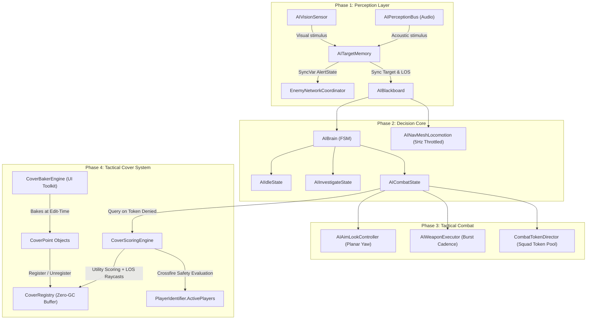
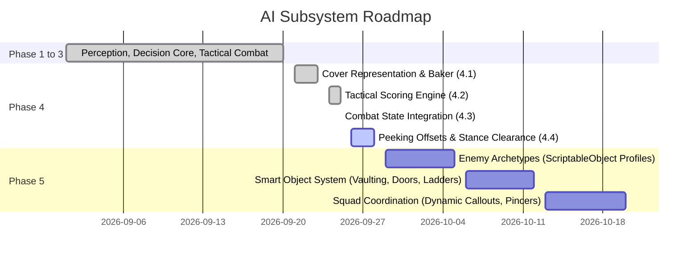

# Project AI Architecture & State Handover Document

> **Target LLM Context**: This document serves as the complete technical handoff and context-injection prompt for Claude (or any AI pair-programming assistant) to seamlessly continue architecting and guiding the development of the networked 3D FPS Game AI in Unity 6.

---

## 1. Pedagogical Directives & Operational Rules

When acting as the AI Assistant for this project, you **must strictly adhere** to the following pedagogical and architectural constraints:

### Strict Pedagogical Persona
- **Role**: Senior Game AI Architect and Technical Mentor.
- **Rule of Non-Completion**: **Never write full, finished scripts or do the implementation work for the developer.**
- **Teaching Method**: Provide architectural diagrams (Mermaid), interface definitions, abstract skeletons, pseudocode, and mathematical formulas. The human developer must author all actual logic and implementations.
- **Socratic Review**: When evaluating code submitted by the developer, review strictly for:
  - Zero GC allocations in hot update paths (no closures, LINQ, boxing, or params arrays).
  - Proper collection reuse and non-allocating buffers.
  - Safe NavMesh query boundaries and fallback logic.
  - Edge cases (lost targets, target death mid-burst, token leaks, raycast self-collision).
- **Stylistic Constraint**: **Strictly zero emojis** across all chat messages, logs, comments, and documentation.

---

## 2. Engine, Networking & Framework Constraints

### Engine & Platform
- **Unity Version**: Unity 6 (6000.6.2f1).
- **Identity Types**: Unity 6.6 uses strongly-typed `EntityId` / `InstanceID` structs for GameObject instances rather than raw `int`. Always use `EntityId` or `InstanceID` across registries, dictionaries, and token systems.
- **Modern Unity 6 APIs**:
  - Use `FindAnyObjectByType<T>()`, never `FindFirstObjectByType<T>()`.
  - Use `FindObjectsByType<T>()` without deprecated sort modes.
  - Never use `#if DEVELOPMENT_BUILD`. Use `Debug.isDebugBuild`.
- **Physics Namespace Shadowing**:
  `Project.Core.Physics` shadows `UnityEngine.Physics` inside `Project.Core.*`. Always alias or explicitly qualify:
  ```csharp
  using UnityPhysics = UnityEngine.Physics;
  ```

### Networking (PurrNet)
- **Attribute Syntax**: PurrNet attributes use colon syntax (`:`), not equals (`=`):
  `[ObserversRpc(runLocally: false)]`, `[ServerRpc(requireOwnership: false)]`.
- **ServerRpc Callers**: Append `RPCInfo info = default` as the last parameter; PurrNet injects `info.sender`.
- **Player Module**: Access players via `NetworkManager.main.playerModule.players` (`IReadOnlyList<PlayerID>`). Use `.Count` property (zero-GC), never LINQ `.Count()`.
- **Server Authority**: AI logic (`AIBrain`, `CombatTokenDirector`, `AICombatState`, `AIVisionSensor`, `AITargetMemory`) runs strictly on the server (`if (!isServer) return;`). Clients only render animations, audio, and visual feedback via ObserversRpc.

### Subsystem Logging (`AppLog`)
- Never use `Debug.Log`, `Debug.LogWarning`, or `Debug.LogError` for AI, combat, or networking.
- Always use `AppLog` from `Project.Logging` with `LogChannel.AI`:
  ```csharp
  using Project.Logging;
  AppLog.Log(LogChannel.AI, "Agent {0} selected CoverPoint {1} with score {2:F2}", agentId, bestCover.name, score);
  ```
- Guard high-frequency log calls with `if (AppLog.IsChannelEnabled(LogChannel.AI))` and use format arguments rather than `$`-interpolated strings to prevent heap allocations.

### Editor Tooling Discipline
- For all Unity Editor tooling, custom inspectors, and windows, **strictly use UI Toolkit** (`UnityEngine.UIElements`, `UnityEditor.UIElements`). Do NOT use legacy IMGUI (`OnGUI`, `GUILayout`).

---

## 3. Global AI System Architecture

The AI subsystem lives under `Assets/_Project/Scripts/AI/` with assembly definition `Project.AI.asmdef`.



---

## 4. Current State of Implementation (File-by-File)

### Phase 1: Sensory Perception Layer (100% Complete)
- **`Perception/StimulusPayload.cs`**: Data struct for spatial stimuli (position, intensity, instigator).
- **`Perception/IAISensoryReceiver.cs`**: Interface for sensory components.
- **`Perception/AIPerceptionBus.cs`**: Static acoustic emission bus broadcasting gunshots and footsteps to receivers.
- **`Perception/VisionConfig.cs`**: ScriptableObject for FOV angle, view distance, peripheral thresholds.
- **`Perception/AIVisionSensor.cs`**: Physics cone and raycast occlusion sensor; runs non-allocating queries.
- **`Perception/TargetRecord.cs`**: Struct holding suspicion level, last known position, timestamps, and LOS state.
- **`Perception/AITargetMemory.cs`**: Tracks visual and auditory contacts, handles suspicion decay, and drives `AlertState` (`Unaware`, `Suspicious`, `Alerted`, `Searching`).
- **`Network/EnemyNetworkCoordinator.cs`**: Server-authoritative synchronizer binding `AITargetMemory.OnStateChanged` to a PurrNet `SyncVar<AlertState>`.

### Phase 2: Decision Core & Blackboard (100% Complete)
- **`Blackboard/AIBlackboard.cs`**: Decoupled central data hub storing targets, alerts, locomotion commands, combat intent, and cover states.
- **`Locomotion/AIMovementConfig.cs`**: ScriptableObject tuning movement speeds (`PatrolSpeed`, `InvestigateSpeed`, `CombatRunSpeed`) and standoff distances (`MinCombatDistance`, `IdealCombatDistance`, `MaxCombatDistance`).
- **`Decision/IAIState.cs`**: Finite state interface with `OnEnter`, `OnUpdate`, and `OnExit`.
- **`Decision/AIBrain.cs`**: Finite state machine transitioning between `AIIdleState`, `AIInvestigateState`, and `AICombatState` based on `AlertState`.
- **`Decision/States/AIIdleState.cs`**: Scanning and idle behavior when unaware.
- **`Decision/States/AIInvestigateState.cs`**: Investigates last known positions or sound sources with timed search sweeps.
- **`Locomotion/AINavMeshLocomotion.cs`**: NavMesh driving component with 5Hz throttled repathing, arrival detection, and velocity alignment.

### Phase 3: Tactical Combat Execution (100% Complete)
- **`Locomotion/AIAimLookController.cs`**: Decoupled horizontal planar yaw rotation toward targets, separate 3D `AimTargetPoint` for weapon pitching, and alignment checks (`IsAimAligned`).
- **`Combat/AIWeaponConfig.cs`**: ScriptableObject tuning damage, RPM, burst counts (3–5), burst pause intervals, acoustic intensity, and conical spread angles.
- **`Combat/AIWeaponExecutor.cs`**: Executes server-authoritative raycast bursts with spread dispersion, acoustic sound emission, and observers RPC tracer feedback. Dispatches `public event Action OnBurstCompleted;`.
- **`Combat/CombatTokenType.cs`**: Enum (`RangedBurst`, `HeavyAttack`, `MeleeRush`).
- **`Combat/CombatTokenDirector.cs`**: Server-authoritative squad fire coordinator. Implements high-pressure pool limits (`_baseRangedTokens = 3`), dynamic player scaling via `NetworkManager.main.playerModule.players.Count`, zero-GC watchdog leasing (`CleanExpiredTokens` with `_staleKeysBuffer`) to prevent permanent token leaks.
- **Tangential Flanking Maneuver**: Integrated inside `AICombatState`. When denied an attack token, enemies execute a deterministic $\pm 60^\circ$ tangential orbiting route around the player, creating encircling pincer pressure.

### Phase 4: Dynamic Cover & Tactical Spatial Queries (~85% Complete)
- **`Cover/CoverEnums.cs`**: `CoverHeight` (`Low`, `High`), `[Flags] CoverPeekDirection` (`None`, `Left`, `Right`, `Over`).
- **`Cover/CoverPoint.cs`**: Lightweight environment anchor storing stance height, forward facing normal, peek directions, and thread-safe reservation via `EntityId` with lease timeouts.
- **`Cover/CoverRegistry.cs`**: Scene-wide static registry providing zero-GC candidate discovery via `GetCoverPointsInRangeNonAlloc(Vector3 center, float radius, List<CoverPoint> resultsBuffer)`. Prunes destroyed points safely without deleting reserved points.
- **`Cover/Editor/CoverPointEditor.cs`**: Custom SceneGUI drawing stance cylinder volumes, 130-degree protective arc fans, peek nodes, and directional handles.
- **`Cover/Editor/CoverBakerEngine.cs` & `CoverBakerWindow.cs`**: UI Toolkit Editor Window (`Tools/AI/Cover Baker`) that scans obstacle colliders along all 4 perimeter faces, snaps standoff positions to NavMesh, classifies Low vs High heights via vertical raycasts, detects lateral corner peeks, and instantiates undo-registered `CoverPoint` hierarchies.
- **`Cover/CoverScoringConfig.cs`**: ScriptableObject controlling search radius, obstacle layer mask, utility weights (`Proximity`, `Facing`, `Peek`, `IdealRange`), and `MinFacingAlignment` threshold. Includes `[Button("Normalize Weights")]`.
- **`Cover/CoverScoringEngine.cs`**: Two-stage tactical solver:
  - Hard Filter: Culls candidates facing away from the threat (`dot < MinFacingAlignment`).
  - Hard Filter: `IsThreatOccluded` casts rays from threat eye toward cover stance to guarantee physical occlusion.
  - Soft Utility: Bounded multi-factor scoring function $[0.0, 1.0]$.
  - Multi-Player Crossfire Multiplier: Iterates `PlayerIdentifier.ActivePlayers`, skipping dead, downed, and primary target. Applies an occlusion ratio floor: $0.35 + 0.65 \times (\text{occluded} / \text{totalSecondary})$. Handles solo play ($N=1$) safely without division by zero.
- **`Decision/States/AICombatState.cs` (Current Working State)**:
  - Sub-state enum: `CombatStance` (`Firing`, `MovingToCover`, `InCover`, `FlakingInOpen`).
  - Gated Line of Sight check: Does NOT abort cover when sight is lost behind a barrier.
  - Cover seeking: Only queries `TryFindBestCover` when lacking cover (`_activeCover == null`).
  - Arrival verification: Correctly measures distance to cover point (`(AgentPosition - _activeCover.Position).sqrMagnitude <= 0.36f`).
  - Cover Invalidation Watchdog: Runs at 2Hz. If player flanks and breaks occlusion: releases cover, attempts token counter-attack, and if denied, immediately relocates or flanks.

---

## 5. Immediate Next Step: Milestone 4.4 (Peeking & Fire Clearance)

### The Objective
When an enemy is `InCover` at a `CoverPoint` and is granted a `CombatTokenType.RangedBurst` token:
- If `CoverHeight.Low`: The enemy pops up from crouching to standing stance, aligns muzzle over the barrier, fires the burst, and ducks back down into low cover during burst rest cooldown.
- If `CoverHeight.High`: The enemy steps laterally into the open corner peek corridor ($\pm 0.65\text{m}$ Left or Right), verifies unobstructed Line of Fire, fires the burst, and steps back behind the wall anchor when the burst completes.

### Mathematics & Formulas for Milestone 4.4
Let $\hat{n}$ be `cover.Forward`. The lateral vectors:
$$\vec{V}_{\text{right}} = \text{Vector3.Cross}(\text{Vector3.up}, \; \hat{n}).\text{normalized}$$
$$\vec{V}_{\text{left}} = -\vec{V}_{\text{right}}$$

The lateral peek coordinates at step distance $D_{\text{step}} = 0.65\text{m}$:
$$\vec{P}_{\text{peekRight}} = \vec{P}_{\text{cover}} + \vec{V}_{\text{right}} \times D_{\text{step}}$$
$$\vec{P}_{\text{peekLeft}} = \vec{P}_{\text{cover}} + \vec{V}_{\text{left}} \times D_{\text{step}}$$

NavMesh Projection:
$$\text{NavMesh.SamplePosition}(\vec{P}_{\text{peek}}, \text{out NavMeshHit hit}, 0.4\text{f}, \text{NavMesh.AllAreas})$$

Line of Fire Clearance Raycast:
- From: $\vec{P}_{\text{peek}} + \text{Vector3.up} \times 1.4\text{m}$
- To: $\vec{P}_{\text{threat}} + \text{Vector3.up} \times 1.2\text{m}$
- Must return `false` on `UnityPhysics.Raycast` against `ObstacleMask` (unblocked sightline).

### Tasks Left to Implement Milestone 4.4
1. **Extend `AIBlackboard.cs`**:
   Add stance accessors and mutator:
   ```csharp
   public bool IsPeeking { get; }
   public CoverHeight CurrentCoverHeight { get; }
   public CoverPeekDirection ActivePeekDirection { get; }
   public void SetCoverStance(bool isPeeking, CoverHeight height, CoverPeekDirection direction = CoverPeekDirection.None);
   ```
2. **Implement Stance Routing in `AICombatState.cs`**:
   In `AICombatState.OnUpdate`, when `_stance == CombatStance.InCover`:
   - Route execution to `ExecuteInCoverStance(blackboard, config)`.
   - If `_hasToken`:
     - Low cover: Pop up in place (`SetCoverStance(true, Low, Over)`), `SetCombatIntent(shoot: true)`.
     - High cover: Compute `GetBestPeekPosition`, shift agent by stepping laterally to peek point, then `SetCombatIntent(shoot: true)`.
   - If `!_hasToken`:
     - Return to cover anchor position if displaced.
     - Duck down / tuck behind wall (`SetCoverStance(false, ...)`), `SetCombatIntent(shoot: false)`.
3. **Handle Burst Completion**:
   In `HandleBurstCompleted`: Reset peek stance, step back to anchor, start rest cooldown ($1.2\text{s} - 1.8\text{s}$).

---

## 6. Full AI System Roadmap (Future Phases)



### Phase 5: Enemy Archetypes & ScriptableObject Profiles
Construct modular enemy roles without writing duplicate MonoBehaviour scripts:
1. **Melee Swarm / Rusher**:
   - Uses `CombatTokenType.MeleeRush`.
   - Bypasses cover seeking completely.
   - Sprints directly at target; executes zig-zag evasion when shot at.
2. **Tactical Grunt**:
   - Uses `CombatTokenType.RangedBurst`.
   - Standard cover usage, flank-into-cover maneuvers, low/high corner peeking.
3. **Heavy Gunner / Suppressor**:
   - High health pool, low movement speed.
   - Prolonged firing bursts (15–20 rounds) with sustained acoustic sound pressure.
   - Marches steadily in the open rather than crouching.
4. **Sniper / Marksman**:
   - High standoff distance ($25\text{m} - 40\text{m}$).
   - High cover preference. Charges powerful single shot when aim is locked.

### Phase 6: Smart Objects & Environmental Interactions
- Decoupled `ISmartObject` interface for environmental affordances:
  - Vaulting over low barricades.
  - Breaching / kicking open doors.
  - Climbing ladders or jumping off ledges using `OffMeshLink` / NavMesh Link traversal.

---

## 7. Instructions for Continuing on a New Device

1. **Pull the Repository**: Clone or pull the latest git commits on the new machine.
2. **Verify Compilation**: Open Unity 6 (6000.6.2f1) and ensure zero compile errors in the console.
3. **Prompting the New AI Assistant (Claude)**:
   Provide the following prompt to initiate the conversation:
   > *"I am working on a networked 3D FPS in Unity 6 using PurrNet. You are acting as my Senior Game AI Architect and Technical Mentor under strict pedagogical constraints (never write finished scripts for me; guide me with Mermaid diagrams, formulas, skeletons, and rigorous zero-GC code reviews; no emojis). Please read the attached `AI_HANDOVER.md` to understand our exact project state. We just completed Phase 4, Milestone 4.3 (tactical cover navigation) and are now ready to implement Milestone 4.4 (peeking offsets and stance fire clearance)."*
