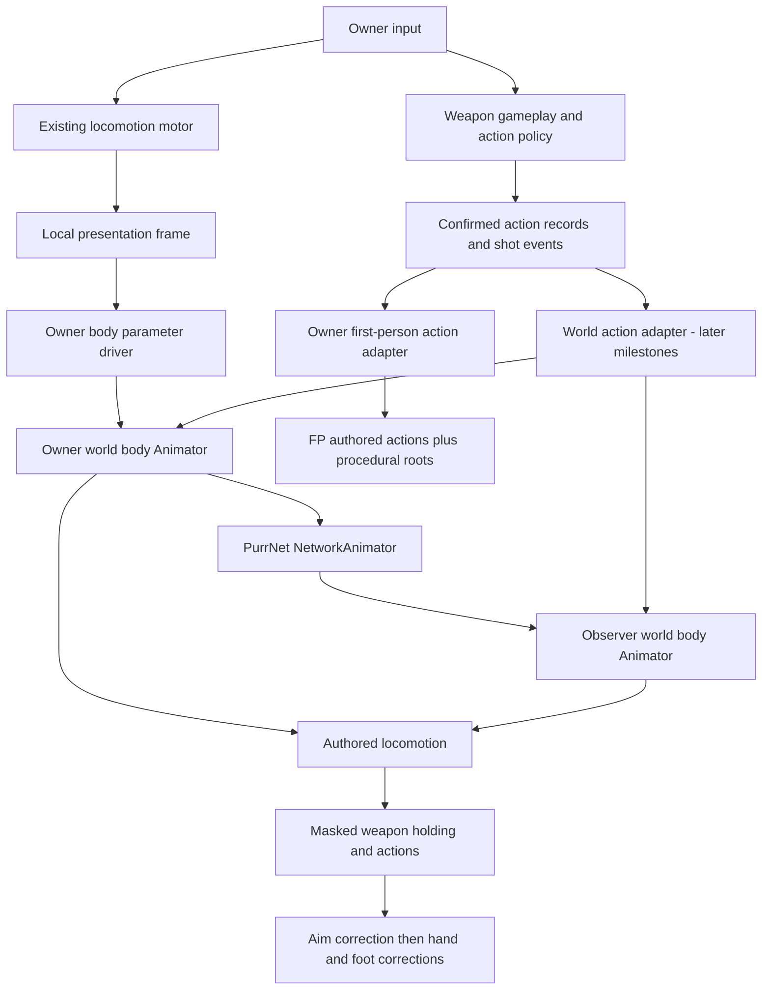

> Historical snapshot preserved on 6 November 2026. Superseded by [the current workflow](../../README.md). Statements below describe earlier plans or checkpoints, not current implementation status.

# Character animation system

Design and migration plan, 28 October 2026. **Proposed architecture, not a claim that the full system is implemented.** The preparatory cleanup and its verified limits are recorded in [Current state](CURRENT-STATE.md).

This folder is the canonical plan for the combined first-person/world-character workflow. `FirstPersonViewmodels.md` remains a detailed export/setup companion; `../../../History/WeaponAnimationPrototype.md` and `Weapon-Animation-ADS-and-Mods.md` retain prototype history and earlier design context. Where their proposed architecture differs, use this plan. The weapon-study reports remain evidence, not integration instructions.

For current code ownership and team onboarding, start with [the project code guide](../../../Architecture.md).
The [29 October cleanup audit](../../../Code-Audit.md) covers the broader gameplay dependencies and verification limits.

**29 October networking decision:** current locomotion uses PurrNet NetworkAnimator's parameter
sync. Prefer the [PurrNet knowledge base](../../../PurrNet.md) and existing components/modules before
adding networking code. Earlier blanket requirements for a custom locomotion snapshot sender
are superseded. Game-specific aim/action data remains subject to its actual requirements.

Read in this order:

1. This document: decisions, ownership, data, networking and locomotion.
2. [Implementation roadmap](IMPLEMENTATION.md): executable milestones, file responsibilities, migration and acceptance gates.
3. [Authoring workflow](AUTHORING.md): what an artist/designer creates and how the team adds content.
4. [Current state](CURRENT-STATE.md): what exists today, cleanup checks and the next concrete step.
5. [Milestone 0 baseline](../../MILESTONE-0.md): connected-host/observer captures, rig/import conventions and the repeatable pistol case.

## 1. The decision

**One gameplay pawn, one semantic action state, two visual presentations.**

- **First-person viewmodel:** owner-only arms and weapon, composed for camera readability. Keep the existing combined exported rigs initially.
- **World character:** full body and world weapon, evaluated for the owner and other clients. Its locomotion, upper-body actions and procedural corrections are independent of the viewmodel's bones.
- **Optional owner lower body:** a visibility treatment of the world-body pose, added after the two presentations work. It is not a second independently controlled locomotion system.
- **Server gameplay:** decides shots, ammunition, reload timing and cancellation. Animation consumes those decisions.

The authored arm clip, locomotion clip and procedural torso aim are complementary inputs to explicitly owned parts of a pose. They are not competing character controllers.



### Why this is a production-shaped approach

Epic documents first-person primitives and a world representation serving different camera, visibility and shadow needs. We adopt that separation in Unity; Unreal's custom projection, anti-clipping, shadow and reflection facilities are renderer features, not automatic benefits of this architecture. Unity equivalents require their own rendering work and tests. [Epic first-person rendering](https://dev.epicgames.com/documentation/en-us/unreal-engine/first-person-rendering)

Lyra demonstrates full-body locomotion layered with upper-body actions, weapon-dependent animation sets, and later corrections such as turn-in-place and stride/orientation warping. Our Unity controllers, motion sets and rig bindings serve similar responsibilities with a smaller initial scope. We are not porting Lyra's graph. [Epic Lyra animation](https://dev.epicgames.com/documentation/en-us/unreal-engine/animation-in-lyra-sample-game-in-unreal-engine)

The recovered FPS ENGINE code supports the authored-actions-plus-procedural-offsets approach. The recovered KINEMATION code informs separate procedural state, rig binding, profiles and action weights. Neither inspected demo establishes a complete multiplayer/world-body solution for GetTheBag. See [study recommendation](C:/Users/pedro/Documents/Codex/2026-10-17/ho/outputs/weapon-animation-study/SYSTEM-RECOMMENDATION.md), [FPS ENGINE evidence](C:/Users/pedro/Documents/Codex/2026-10-17/ho/outputs/weapon-animation-study/fps-engine-151/ANALYSIS.md), and [native-analysis limits](C:/Users/pedro/Documents/Codex/2026-10-17/ho/outputs/weapon-animation-study/NATIVE-FOLLOWUP.md).

## 2. Current audit: preserve versus migrate

Source and saved-prefab audit on 28 October, updated after the preparatory cleanup. Host presentation checks passed; a fresh separate-client animation baseline is still required.

| Current implementation | Migration decision |
|---|---|
| PlayerWeaponController owns server ammo, cadence, reload deadline and accepted shots | Retain authority; extend action records rather than letting Animators decide outcomes |
| WeaponEquipmentState has Action and EquipRevision, but no action identity/start time/duration/variant | Add an explicit action record for seek, cancellation and late join |
| WeaponShot has Sequence and Slot, but no EquipRevision | Include equipment identity so an old shot cannot animate a replacement visual with the same weapon ID |
| Presenter chooses FP for owner or world weapon for observers | Support two independent bindings: owner FP plus world weapon for every rendered character, including owner shadows |
| WeaponInstance exposes Fired and reload bool/timing | Keep as a temporary adapter; graduate to typed action/shot notifications |
| WeaponAnimator uses Fire/Reload state names and one serialized reload length | Migrate to validated clip bindings and semantic action IDs; retain the old adapter until parity tests pass |
| ADS, AimReference editor calibration, look sway, movement sway and recoil work as separate roots | Preserve their values and GUIDs; feed them one view context and explicit weights |
| FirstPersonWeaponMotion now groups owner ADS and procedural update/reset orchestration | Keep the presenter responsible for generation-safe loading; extend this binding when shared presentation data exists |
| LocomotionController and its motor are disabled on non-owners | NetworkAnimator supplies observer body parameters; never overwrite them from the dormant controller's default State |
| Motor rotation follows camera yaw directly | Keep gameplay yaw first; introduce independent visual body facing in a later turn-in-place milestone |
| Body Animator is Humanoid, with locomotion plus masked Pistol Hold | Reuse it as the world-body starting point |
| Body Animator Apply Root Motion remains enabled | Disable automatic application for motor-driven locomotion and validate each clip's import trajectory |
| UpperBodyRig/ChestAim now live under the body Animator | Retain the setup; calibrate per rig and layer its weights with actions |
| PlayerAimTarget drives a NetworkTransform on BodyAimTarget | Keep as a working prototype until compact aim snapshots replace it, then remove only the target's redundant NetworkTransform |
| PlayerAimTarget now uses camera world forward | Preserve the corrected direction convention when replacing the target transform stream with compact look snapshots |
| Presenter currently hides owner world meshes via ShadowsOnly | Make visibility a character-level policy rather than a weapon component side effect |

Source anchors: [presenter](../../../../Assets/_Project/Scripts/Runtime/Gameplay/Player/Combat/PlayerWeaponPresenter.cs), [controller](../../../../Assets/_Project/Scripts/Runtime/Gameplay/Player/Combat/PlayerWeaponController.cs), [equipment](../../../../Assets/_Project/Scripts/Runtime/Gameplay/Combat/Weapons/WeaponEquipmentState.cs), [locomotion](../../../../Assets/_Project/Scripts/Runtime/Gameplay/Player/Locomotion/LocomotionController.cs), [aim target](../../../../Assets/_Project/Scripts/Runtime/Gameplay/Player/Animation/PlayerAimTarget.cs). Paths in this table refer to current code; proposed type names below do not imply files already exist.

## 3. What must be authored, and what should be procedural?

| Feature | Authored contribution | Procedural contribution | Initial decision |
|---|---|---|---|
| Walking/strafe/crouch/run | In-place body loops and later starts/stops | Velocity-driven blends and limited play-rate adjustment | Authored locomotion first |
| Jump/fall/land | Body takeoff/fall/landing poses or clips | Ground/vertical-speed state selects and weights them | Add after grounded locomotion |
| Feet | Contact and gait in the clips | Later terrain foot IK and small pelvis adjustment | Do not generate walking with IK |
| Torso aiming | Calibrated weapon holding pose | Limited spine/chest aim correction or later additive aim poses | Start with calibrated rig constraints |
| Head looking | Neutral head/neck pose | Limited look correction | Separate from weapon aim; add after chest |
| Turning in place | Left/right turn clips | Body-yaw state, trigger/phase and visual root correction | Add only after straight/strafe locomotion |
| FP fire | Fingers, slide/bolt and intentional hand motion | Existing small recoil spring | Tune combined result |
| Reload | Hands, magazine, bolt/slide choreography | Time scaling, phase seeking, grip IK release | Never invent reload choreography with IK |
| Equip/inspect/interact | Intentional action clips/poses | Variant choice, blending, optional contact correction | Add through the same action contract |
| ADS | Holding pose plus sight marker placement | Marker calibration, blend and camera FOV composition | Preserve existing system |
| Sway/bob | Existing clip motion remains part of the baseline | Look sway, movement response; later distance-driven bob | Independently weighted |
| Hand grip | Appropriate holding/action pose | Support-hand IK to weapon/attachment grips | Add when world holding works |

**No procedural walking system is required for this game.** Begin with reliable authored gait. Foot IK corrects contact; stride warping adjusts a gait; neither removes the need for movement animation coverage. Fully procedural locomotion is a separate project with its own gait planning and foot placement problems.

Do not require one clip for every combination such as walking + pistol + looking up + reloading. Compose locomotion, an upper-body action and aim/IK corrections. A weapon category can reuse locomotion and holding sets when its poses are compatible.

## 4. Ownership and evaluation order

### Gameplay and visual roots

```text
PlayerPawn [network identity, gameplay state]
└── Character/MotorRoot [existing motor + root NetworkTransform]
    ├── WorldVisualYaw [visual orientation only]
    │   └── BodyModel [Animator + RigBuilder]
    │       ├── Skeleton
    │       │   └── DominantHand/WorldWeaponSocket/WorldWeapon
    │       ├── AimTargets [reconstructed locally]
    │       └── Rigs: BodyAim -> SupportHand -> FootPlacement
    └── Existing gameplay camera pivots and CameraTarget
        └── ViewmodelSocket [owner visual]
            └── FPWeaponView
                └── AimMotionRoot
                    └── SwayRoot
                        └── MovementRoot
                            └── RecoilRoot
                                └── OptionalBobRoot
                                    └── ExportedModel [Animator, arms + gun bones]
```

The existing nested FP roots are acceptable at this scale. A future single pose composer can replace them after profiling or demonstrated ordering problems; preserve authored values and contracts if that happens. Animator-owned bone paths do not change when adding a parent above the model's Animator.

| Owner | Sole write responsibility |
|---|---|
| Locomotion motor | Gameplay root translation, collision, stance height and gameplay yaw |
| Visual body-facing controller | WorldVisualYaw, never motor translation |
| Body Animator | Authored body skeleton pose |
| Rig jobs | Declared corrections after the Animator; no competing LateUpdate bone writer |
| World weapon socket | Carries world weapon from dominant hand |
| Mechanism Animator/driver | World slide/bolt/magazine beneath its socket |
| FP Animator | Authored FP skeleton and mechanism |
| Each FP procedural layer | Its dedicated parent only |
| Existing camera controller | Look/aim orientation and composed FOV |
| Rendering policy | Camera/layer visibility and shadow/reflection inclusion |

For the world weapon, start with hand-driven attachment: the weapon follows the dominant hand, the support hand optionally follows its grip. Never constrain that dominant hand back to the same weapon root. If a later aim rig makes the weapon the master, replace this ownership scheme explicitly.

### Frame/tick order

1. Sample owner input; run the existing motor and gameplay updates in their existing loops.
2. Capture post-movement presentation data at a documented motor callback/tick, rather than relying on incidental Update order.
3. Feed owner body parameters from capture. NetworkAnimator applies observer parameters through its supported path. Prepare action/rig inputs before evaluation; review timing against root interpolation before adding custom buffers.
4. Animator evaluates locomotion and masked action layers; RigBuilder applies aim then hand/foot corrections.
5. FP procedural roots compose once for the rendered frame, using the owner view context. Shot events add impulses; they do not directly run a second transform update.

RigBuilder extends the Animator evaluation graph and its rig layers affect that hierarchy. Source targets must be ready before that evaluation. [Unity rigging workflow](https://docs.unity.cn/Packages/com.unity.animation.rigging@1.2/manual/RiggingWorkflow.html)

## 5. The small set of concepts developers work with

These are proposed responsibilities. Implement only the minimum needed at each milestone.

| Concept | Contains | Never contains |
|---|---|---|
| CharacterVisualDefinition | Appearance ID, body prefab, rig family, compatible FP arms family, body set, renderer groups, bone bindings | Ammo/cadence or live network state |
| WeaponPresentationDefinition | Weapon ID, world prefab, compatible FP view bindings, body-pose family, action/motion sets, procedural profile | Per-player spring velocities |
| Action catalog | Semantic action/variant IDs, eligibility/selection policy, interruption policy and duration-policy reference | Bone paths or Animator state names in RPC code |
| ViewMotionSet | Rig-family + view-specific mapping from action/variant IDs to clips, masks, phase/rate and cosmetic markers | Authority to grant ammo |
| BodyAnimationSet | Locomotion clips, nominal gait speeds, masks, aim/turn limits and holding families | Local input lookup |
| RigBinding | Animator, validated bones, sockets, sight/grip references, renderer groups | Per-frame global hierarchy searches |
| Action record | Chosen action, chosen variant, identity, start time, frozen duration and current status | Animator hashes or renderer instances |
| Presentation context | Interpolated movement/look/action/ownership data for this frame | Authority to change gameplay |

Shared assets contain immutable authoring data. Binding handles, current action, blends, prop visibility, spring velocities and IK targets belong to per-instance runtime objects.

### Multiple weapons and character models

- Give each supported skeleton a **rig family ID**, not a claim of universal compatibility.
- First-person Generic clips require compatible hierarchy/bone names; changing hand proportions can still require weight/pose adjustments. Retargeting is an explicit authoring/import step.
- Begin with combined FP prefab exports per weapon and FP arms rig family. This preserves the existing working authoring method.
- Sleeve/material variants on the same skeleton can reuse animation. Incompatible arms require a compatible view binding or explicit unsupported-content result.
- Body skins that share a Humanoid setup can reuse body motion sets, but still validate avatar mapping, proportions, sockets and grips. Humanoid retargeting does not guarantee magazine/weapon contact.
- A body animation set can support a shared Pistol family and Rifle family. Only create bespoke per-weapon overrides when the grip/action genuinely differs.
- Definition resolution is deterministic: exact compatible override -> explicit rig/weapon-family default -> explicit optional-action fallback -> validation failure. Never silently play an incompatible rig clip.
- Starter fallback for a missing body inspect can be the holding pose. Required fire/reload content must be reported by validation. Gameplay continues safely if a visual fails to load.

Support multiple models through compatible data first. A shared interchangeable FP skeleton with runtime skin swapping can become an optimization later, after a second arms family demonstrates what actually varies.

## 6. Action and variant contract

Use stable semantic identifiers. Keep `Reload` as the action and `Tactical`/`Empty` as variants; keep `Inspect` with `Common`/`Rare` variants. Adding a clip variant must not require another network enum value, controller RPC, or full controller graph.

```text
Action: Reload
  Tactical -> FP clip + body clip + world mechanism clip
  Empty    -> FP clip + body clip + world mechanism clip

Action: Inspect
  Common [eligible, weight 95] -> view motions
  Rare   [eligible, weight 5]  -> view motions
```

Those example weights are a design choice, not recovered demo settings.

### Minimum action record

| Field | Meaning |
|---|---|
| Actor/spawn identity | Prevents events from a previous pawn lifetime being reused |
| Equipment revision + slot | Identifies the equipped binding generation; add item-instance ID if duplicate persistent items become possible |
| Action sequence | Monotonic identity for replacement, cancellation and deduplication |
| Action ID + variant ID | Semantic decision shared by every view |
| Start server tick + duration ticks | Frozen timing in a shared clock domain |
| Status | Active/completed/cancelled, with matching sequence |
| Optional cosmetic seed | Stable randomness when variation actually requires it |

Shots remain their own sequence-bearing events so firing/recoil does not require a long-lived action transition per rendered frame. Extend the current shot payload with equipment revision; do not discard the useful existing Sequence/Slot data.

### Selection, timing and cancellation

1. Server accepts a gameplay action, captures eligibility at its start and chooses its variant once.
2. Resolve duration from gameplay definitions/stat policy, then freeze it for that action. Clip length never controls the server deadline. Decide explicitly whether changing attachments during an action cancels it; do not silently change its duration halfway through.
3. For optional replicated inspect, the server validates the presentation request and chooses/accepts the variant. Observers do not independently roll rare/common chances.
4. Both views resolve the same variant ID through their compatible motion sets. They may have different clips and masks.
5. For constant-rate clips: `phase = clamp01((renderTick - startTick) / durationTicks)` and `stateSpeedMultiplier = clipLengthSeconds / durationSeconds`, assuming base state speed 1. Rate modifiers must be validated, not multiplied accidentally twice.
6. A late visual seeks to phase. Completed transient effects are not replayed from the beginning. A cancelled action leaves props/IK in an explicitly restored state.
7. A stop/cancel applies only to the matching action sequence and equipment generation, and only releases the visual channels that action owns. It cannot interrupt a newer fire or equip.

Normalize cosmetic contact markers to action phase. If body/FP magazine contacts need alignment, author both to the same marker phases or add an explicit piecewise phase map later. Separate gameplay commit points from cosmetic sound/visibility/hand-contact markers. Seek reconstructs persistent state at the current phase; it skips old one-shot sounds and consumes crossed markers once per action identity.

### Initial playback backend: fixed Animator slots

Keep Animator Controllers for locomotion and a small fixed action contract. FP uses Idle, Fire and an exclusive Action slot. Body uses locomotion, a masked WeaponHold layer and a masked Action slot; short fire feedback is an explicitly assigned slot/layer, with additive blending only when the clip was authored as additive. World mechanism animation has its own matching slot contract.

Use a per-instance AnimatorOverrideController to bind the selected motion set/variant into those fixed clip slots at equip/action boundaries. Install the selected clip before entering/seeking the action state. Never mutate a shared controller, reassign overrides every frame, or change Animator.speed globally. Resolve the actual chosen clip's duration rather than retaining one manually entered reload length. Validate transition/parameter continuity when swapping overrides, particularly while cancelling or replacing an active action. The same semantic variant maps independently into FP/body/mechanism overrides.

This gives artists reusable controller templates and data slots without requiring an Animator state per variant. A custom Playables action mixer is a later backend option if layered overlap requirements justify it; it must integrate with RigBuilder's graph explicitly. Do not introduce a second competing animation graph as part of the first slice.

### Empty reload and slide-open behavior

Current gameplay tracks magazine/reserve ammo, not a separate chamber round. Initially select `Empty` using the confirmed magazine count at reload start for weapons configured to support that variant. Do not imply this models every firearm's chamber behavior.

A pistol that stays open after its last shot also needs persistent mechanism presentation, not just an empty-reload clip: derive/replicate a supported `SlideLockedOpen` state, include post-shot ammo/mechanism information, and keep that pose through idle until the accepted reload/action releases it. Both world and FP mechanism views consume the same state. Restore that state after cancellation/late loading. Add separate chamber simulation only if gameplay actually requires it.

### Initial action priority

Death/downed supersedes weapon actions; equipment replacement invalidates old actions; reload and a hand-occupying interaction are exclusive; inspect yields to fire/reload/equip. ADS/sprint permissions are separate gameplay/presentation policies. Reload owns upper-body/hand/prop channels; legs can continue locomotion when movement is allowed. Vault/downed can own the full body and fade the weapon overlay out. Authority remains in the gameplay/action layer, not a hierarchy of Animator exit-time transitions.

## 7. Network contract and clock

Preserve the current owner-driven motor/root NetworkTransform and server-driven weapon gameplay during this migration. This plan does not convert character movement to server simulation or implement prediction/rewind.

| Stream | Authority/source | Delivery/use |
|---|---|---|
| Root movement | Existing movement networking | Keep current root replication and interpolation |
| Body locomotion parameters | Owner's BodyAnimationDriver via NetworkAnimator | Built-in automatic parameter sync to observers |
| Additional aim/action data, if needed | Authority chosen for that feature | Inspect existing components/sync types first; custom timestamped transport needs a demonstrated gap |
| Equipment/appearance/current action | Server-approved persistent state | Spawn/late join reconstructs current state |
| Accepted shot | Existing server shot path | Once per sequence/equipment generation; presentation never grants damage |
| Cosmetic inspect request | Owner request, validated selection | One chosen replicated action/variant if remote visibility is required |

Current locomotion sends Animator parameters through NetworkAnimator; its local frame is not a
packet. Select the parameters needed by the body controller. Keep viewmodel springs and local
IK calculations local. For future additional aim/action data, first consider existing sync types
or component APIs. Only if a custom pose stream is justified, define its tick/sequence, necessary
movement/stance/aim fields and reset identity without duplicating the existing parameter stream.

For custom gameplay requests/data, validate finite values, caller authority, identities, ranges and
rate as appropriate. Built-in cosmetic parameter sync does not authorize ammunition, damage or
movement changes. Review root/body/aim timing under latency before choosing extra clock/buffer code.

Use the built-in component's supported scheduling for current locomotion and measure its result.
If custom continuous pose data becomes necessary, choose its rate/delivery through measurement;
15–20 Hz is only an initial experimental budget for that future stream. Actions still need current-state
convergence and spawn/equipment/action identities when separate messages can arrive out of order.

The installed PurrNet TickManager exposes `syncedTick`, `syncedPreciseTick` and `tickRate` through NetworkManager.tickModule. Put that integration behind a small presentation-clock adapter. Prefer double-precision tick-to-seconds conversion; handle connection epochs, clock corrections and uint tick wrap. Verify host/client behavior before adopting it as the action clock. Do not use rollbackTick as a display clock or subtract client Time.timeAsDouble from a server timestamp.

When migrating reload timing, move the gameplay deadline and the replicated action timing to the same clock contract together. The current gameplay deadline uses Time.timeAsDouble, while PurrNet ticks have their own pacing. Define multiplayer pause/time-scaling behavior explicitly; otherwise an unscaled presentation clock and a scaled gameplay deadline can disagree even on the host.

For future timed aim/action playback, inspect the installed NetworkAnimator/NetworkTransform timing
first and coordinate only the missing game-specific timing. A shared custom playback clock is a
possible response to a demonstrated mismatch, not a prerequisite for working locomotion. Optional
prediction still needs request identity and reconciliation to avoid playing an action twice.

### Spawn, loss and recovery

Verify NetworkAnimator's current body-state restoration for late observation. Game-specific late-join
data includes appearance/equipment IDs, any additional aim state, current action identity/timing and
mechanism state. Async binding applies the latest state only after its generation is accepted.
Ownership changes rebuild owner-only view bindings. Disconnect/despawn clears visual handles,
subscriptions, springs, IK targets and action instances. Gameplay must run without rendering dependencies.

Keep BodyAimTarget's working NetworkTransform while reviewing whether an existing parameter or
sync-type path would simplify it. Replace it only after an alternative passes real observer tests.
A replacement target reconstructed from origin/direction needs one writer; remove the old target's
stream only after parity. Keep the pawn root NetworkTransform.

## 8. Locomotion and body-facing implementation

### Keep the motor, expose a presentation sample

Add a read-only capture/event at the appropriate motor update boundary: actual planar/vertical velocity, stable-ground status, phase, crouch/sprint/slide/downed/dragging, gameplay yaw, optional landing impact speed, and a teleport/discontinuity identity. First capture the owner's actual motor state; observers consume replicated/rendered state, since their motor/controller is disabled.

Input drives requested movement and the existing FP movement sway. **Actual displacement/velocity drives world walking.** Pressing W into a wall should not produce a full-speed running cycle. Subtract supporting-platform motion when deriving gait where the motor provides that distinction; otherwise document the limitation and test train/platform cases. Teleports must reset velocity estimates rather than create a huge stride/recoil impulse.

### Animator contract

Keep one body controller per compatible body rig family, with validated parameters such as local VelocityX/VelocityZ, Grounded, VerticalSpeed, Stance, MovementPhase and weapon holding family. Map legacy controller names through one adapter during migration instead of scattering string calls.

Base locomotion: standing directional blend tree; crouch directional blend tree; sprint; jump/fall/land; slide/downed as explicit states. Upper body: weapon holding plus one action slot masked to the intended bones. Full-body actions override that overlay under declared priority. Aim/IK evaluates after these authored poses. Unity provides Override/Additive layer blending and masks; choose Override for a full holding/reload pose, and Additive only for clips authored against a compatible reference. [Unity animation layers](https://docs.unity.com/en-us/engine/6000.7/manual/animation-section/animation-mecanim/animation-animator-controller/animation-state-machines/animation-layers)

Use 2D directional blending in **visual body space**, with dead zones/hysteresis to avoid idle flicker. Initial forward/back/left/right clips are enough to test; add diagonals if the blend looks poor. Normalize against each gait's authored nominal speed. Adjust locomotion state playback within a bounded range rather than scaling Animator.speed globally. Foot IK cannot fix a badly mismatched gait speed.

Automatic Apply Root Motion stays off because the motor owns gameplay motion. Inspect the clip's root trajectory/baking settings as well: toggling the Animator alone does not fix a translating skeleton inside the model. Special traversal root motion, if desired later, requires an explicit motor trajectory contract; never let an animation silently move the network capsule.

### Facing without twisting the legs

First milestone: body visual yaw follows gameplay yaw, with chest pitch correction. Next, keep the motor's existing yaw behavior and add WorldVisualYaw for bounded visual counter-rotation while idle. This prevents the gameplay/camera heading from being rewritten to improve foot appearance.

Store visual body yaw separately from aim yaw. Idle: allow a limited torso yaw difference, then use a turn clip to catch the body up. Moving: blend body facing toward gameplay/aim facing while choosing strafe/back clips from local velocity. Airborne/vault/downed: use an explicit facing policy. Clamp torso twist; a camera's full pitch range need not be copied one-for-one into one chest bone.

Turn clips can carry a visual-yaw curve consumed by the facing controller with motor root-motion application still off. Do not both apply that curve and reapply the same root rotation from the clip. Aim yaw relative to the body is recomputed after visual turning. This is a later milestone, not a prerequisite for the first two-client slice.

### Feet and hand corrections

After gait and facing work, add foot rays/IK for visible characters only: ground layers exclude the player/weapon, slopes and stairs are clamped, moving-platform contact is tested, and airborne feet are released. Hand IK uses explicit targets/hints and action-phase weights. Reload and interactions release the affected hand; foot correction does not steer network position. Head look has separate limits and reduced weight during authored head motion.

## 9. Rendering and local legs

| Representation | Owner main view | Other player views | Shadows/reflections |
|---|---|---|---|
| FP arms + FP weapon | Visible | Hidden | Avoid duplicate world shadows; FP self-shadowing is a separate renderer decision |
| World full body + world weapon | Hidden initially | Visible | Owner world body and weapon supply one consistent shadow representation |
| Optional local lower body | Visible when looking down | Not an extra remote character | Shares body pose; manage shadow duplication explicitly |

The owner must also have a world weapon instance for its world-body shadow/representation; the current choose-FP-or-TP presenter does not provide both. Only one view owns each sound/muzzle/impact cue for a given recipient. Audio/effects are dispatched by accepted shot identity and observer role, not by both meshes independently firing animation events.

Do not hide the entire network pawn to hide the owner's head. Use renderer groups/per-camera layers. For local visible legs, prefer separate lower-body geometry skinned to the already evaluated world skeleton. A single indivisible mesh needs authoring separation or a deliberately tested rendering mask; Avatar Masks affect animation, not mesh visibility. Avoid a second unrelated leg Animator.

Start with one world-camera projection and the existing FP presentation. If the FP clipping/FOV problem remains, prototype a Unity URP viewmodel camera/pass with a declared depth/lighting policy. Always-on-top drawing can make guns appear through walls, so pair it with a near-wall response if used. Camera stacks, shadows, mirrors/reflections, post-processing and culling must be tested in the actual Unity renderer; Epic's capabilities are a design reference, not Unity feature parity.

Spectator/third-person cameras consume the world representation. Death/ownership changes remove owner-only visuals and reset FOV. New body models bind sockets/renderer groups through their visual definition, not hard-coded Mixamo paths in gameplay code.

## 10. Developer-facing rules and migration boundaries

- One obvious entry point: Character presentation receives state; gameplay never calls arbitrary Animator states.
- Keep PlayerWeaponPresenter as the generation-safe visual loader initially. Add separate FP/world bindings and a body driver rather than rewriting Addressables and weapon authority together.
- Keep existing WeaponAnimator/WeaponInstance events behind an adapter while one catalog-driven action path reaches parity. Remove the old event path only when no consumer relies on it; do not subscribe both and double-play actions.
- Introduce a body/presentation driver in Project.Player; reusable weapon-view components stay in Project.Combat. Asset/data types go in the existing Definitions/Content boundary without adding a Combat -> Player cycle. Editor validation remains Editor-only; adding typed Animation Rigging references requires the appropriate asmdef update and assembly validation.
- Preserve prefab GUIDs and serialized tuning; use FormerlySerializedAs for field migrations. Use explicit asset converters with dry-run reports, Undo and versioning. Do not overwrite animation imports while converting data.
- Rig validation reports exact missing references, clip mappings, states, masks, unsupported pairs and phase errors before Play Mode. Required slots fail validation; optional slots have named fallbacks.
- A debug panel shows actor/view, rig family, weapon, equipment/action sequence, variant, phase, clock, aim/body yaw and procedural weights. It also lets developers mute individual visual contributions for diagnosis without changing gameplay.
- New content should be added with assets and registration, not a new Animator script per pistol/rifle or another RPC per animation.

## 11. Definition of a first successful slice

One body, one FP arms family and one pistol. Two connected clients can walk/strafe, aim continuously, fire and reload. The owner sees the existing FP view; each observer sees a full body with a world pistol. Owner shadows include the world weapon. The same confirmed action record drives both views, late loading seeks correctly, old events cannot affect a new equip, and gameplay remains functional without visuals.

Empty reload, rare inspect, a second weapon and a second appearance are explicit extension tests in the roadmap, not reasons to build every feature before validating this slice.
