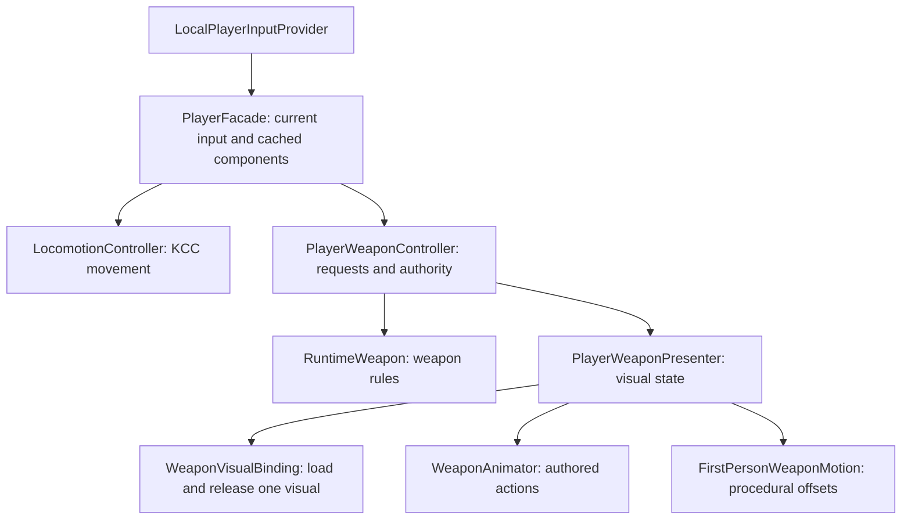

# Get the Bag: code guide

Start here when joining the project. Custom source is in `Assets/_Project/Scripts`.
Folders describe responsibility; `.asmdef` files enforce which modules can use each other.
Every namespace starts with its assembly's root namespace (`Project.Match`, `Project.Definitions.Weapons`).
Naming, prefixes and folder rules for scripts and assets are in [Conventions.md](Conventions.md).

For networking decisions, consult [the PurrNet knowledge base](PurrNet.md) and verify the installed
version before adding transport code. Prefer PurrNet's existing components and modules.

## Where things belong

| Folder under Scripts | Owns | Start reading here |
| --- | --- | --- |
| Runtime/Application | Startup order and shutting down the session | Bootstrap/GameBootstrap, Lifecycle/GameLifetime |
| Runtime/Content | Shared definitions, registries and loaded content | Loading/GameContent, Definitions/Weapons/WeaponDefinition |
| Runtime/Foundation/Core | Small shared contracts, input data, player identity, UI blocking and physics utilities | Input/PlayerInputData, Interaction/IInteractable, Player/PlayerIdentifier |
| Runtime/Gameplay/Player | Player input, movement, interactions, equipment and character presentation | Context/PlayerFacade, Locomotion/LocomotionController |
| Runtime/Gameplay/Combat | Health, damage, shots, firing strategies and weapon visual effects | Weapons/WeaponFireStrategies, Health/HealthComponent |
| Runtime/Gameplay/AI | Perception, decisions, movement, cover and AI weapon execution | Blackboard/AIBlackboard, Decision/AIBrain |
| Runtime/Gameplay/Loot | World loot and bag interactions | LootInteractable, LootSpawnService, World/WorldDuffleBag |
| Runtime/Gameplay/Match | Raids, hub level launch, spawn points and extraction zones | RaidManager, LevelLaunchController, SpawnPoint |
| Runtime/Infrastructure | Networking, persistence and logging | Networking/Bootstrapping/ConnectionStarter, Persistence/DataPersistenceManager, Logging/AppLog |
| Runtime/Presentation/UI | HUDs and menus that display gameplay state | Core/PlayerHUDBinder, Interaction/InteractionPromptUI |
| Editor | Inspectors, validation, gizmos and authoring tools | Weapons/Presentation/AnimationValidationCommands |
| Development | Debug helpers and test scene utilities | Harnesses/SceneTestHarness |

Application code can coordinate several modules. Gameplay code must not call the application bootstrap.
`Project.Content` exposes ready-to-use registries to gameplay without creating that reverse dependency.
Infrastructure holds external operations; UI observes gameplay rather than owning gameplay rules.
Do not move a working class just to make every folder equally small.

## Follow a player from input to animation

`LocalPlayerContext` identifies the local player for HUD/input consumers. `PlayerIdentifier`
tracks network identity. `PlayerFacade` caches components; it is not the owner of every player feature.
Console commands use `PlayerFacade.Find` and then its cached components instead of repeating scene searches.

`LocomotionController` remains the movement authority and KCC callback entry point. Read its
configuration and main methods first; its grounded, airborne, vaulting and noclip handlers are at the end.
`LocomotionData` contains the existing input/state structs. `VaultDetector` performs the vault physics queries;
the controller still decides when to vault. Editor-only drawings live in `Editor/Core/LocomotionGizmos`.
Movement owns the actor root. Animation must not independently move that root.

## Weapon gameplay and visuals

`WeaponDefinition` describes gameplay tuning and prefab references. `WeaponPresentationDefinition`
describes visual compatibility/tuning. `Player/Combat/RuntimeWeapon` handles fire scheduling, ammunition and reload
rules; `PlayerWeaponController` coordinates player requests and network state. The presenter consumes
that state and does not decide whether a shot or reload is legal.

The owning player has an FP visual plus a world visual. Other players use the world visual.
`WeaponVisualBinding` owns the Addressables load/instance/release for one view.
The presenter's request version and cancellation protect against a slow old equip replacing a newer one.
Keep those guards when changing loading; they serve real equip/despawn cases.

`WeaponAnimator` drives authored idle/fire/reload clips. `FirstPersonWeaponMotion` combines the
existing aim, sway and recoil calculations, then applies their result to the assigned procedural root.
`CharacterRigBinding` declares sockets, body Animator and renderer groups.
`CharacterVisualVisibility` applies owner/observer visibility to those groups.

`BodyAnimationDriver` is currently a frame-to-Animator adapter, with parameter, finite-value and root-motion
guards. `CharacterPresentationCapture` now feeds local post-motor velocity/grounded frames into it.
The saved body's owner-authoritative `NetworkAnimator` automatically synchronizes its parameters;
observer Animators consume that stream. A separate presentation snapshot sender is not required for
current locomotion. The user reports standing locomotion and replication working; broader stance,
late-join and latency coverage remain to be verified. See [the PurrNet decision](PurrNet.md).

For animation work, start with [the current workflow](Animation/README.md).
[Authoring](Animation/AUTHORING.md) describes the art responsibilities and working setup;
[implementation steps](Animation/IMPLEMENTATION.md) separate the upcoming tooling from
[what exists today](Animation/CURRENT-STATE.md). Earlier milestone plans are historical reference.

## AI and match logic

An AI sensor feeds target memory. `AIBrain` selects an existing `IAIState`; `AIBlackboard` holds the
components and runtime facts those states use. Navigation controls movement; the weapon executor controls
firing. Cover scoring, peek validation and combat-token allocation already have separate owners.
Add a behavior beside those owners rather than putting perception, navigation and firing into one state.
`AICombatState` names its return-to-cover and active-peek steps explicitly.

`SpawnPoint` validates one authored location; `ValidatedSpawnPointProvider` selects a location for PurrNet.
The matching gizmo drawer is editor-only. `AreaPlayerDetector` counts players, tracking multiple colliders
per player so one collider leaving does not necessarily mean that player left the zone.
`RaidManager`, transit and zone components consume that occupancy state.

## Startup, networking and saves

`GameBootstrap` installs the content/session startup gate, ensures services and loads content.
`ConnectionStarter` waits for that gate before connecting. `GameLifetime` coordinates shutdown.
`GameContent` owns registry handles and releases them when its lifetime ends.
`NetworkSceneCoordinator` owns synchronized scene changes. Keep server checks, RPC ownership rules and
sender validation in the module that owns the authoritative action.

`DataPersistenceManager` gathers `IDataPersistence` participants, serializes saves with its semaphore,
and delegates file operations to `FileDataHandler`. The handler uses native file APIs and maintains the
existing backup format. Cancellation propagates as cancellation; it must not be treated as corruption.
Async save failures propagate to the manager, so success is logged only after a successful awaited save.
Synchronous save behavior and the on-disk format remain as before.

UI blocker policy stays in `UIBlockerSystem`; a window registers its blocking requirements instead of
individually toggling gameplay action maps. `InteractionPromptUI` formats tap/hold prompts and manages
its own shake cleanup. Gameplay permission comes from `IInteractable.CanInteract`.

## A predictable workflow for new work

1. Find the feature owner in the table and read its immediate caller and dependency before editing.
2. Make the smallest change there. Extract a named function when it clarifies a concrete step.
   Create a separate class when that step has a separate responsibility, not just to shorten the file.
3. Reuse existing contracts and registries. Introduce an interface only when actual implementations need it.
4. Keep serialized field names, types and asset GUIDs intact. Reconnect editor references deliberately when
   changing a prefab contract. Keep runtime helpers outside the saved object graph where possible.
5. Use contextual `AppLog` diagnostics. Avoid logging or allocating formatted strings every frame.
6. Compile in Unity. After assembly changes, run `./Tools/Validate-Assemblies.ps1` from the project root.
   Then exercise the changed behavior in Play Mode; multiplayer changes need a host and a client.

To add a weapon, first create its definition/prefabs and registry entry, bind its sockets and animation
profile, then run the animation menu validators. See [Animation/WEAPON-LOADING.md](Animation/WEAPON-LOADING.md).
To add a new reload/inspect variation, change the action's data selection and its visual handling at the
appropriate roadmap stage; do not add a new all-purpose player manager or duplicate the entire weapon controller.

The cleanup coverage, checks and remaining risks are recorded in [Code-Audit.md](Code-Audit.md).
