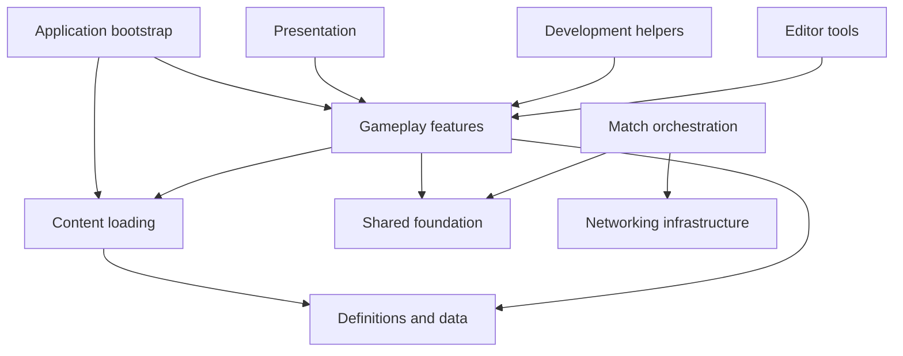

# Script architecture

This project uses feature assemblies within a layered runtime structure. Folder names describe ownership; assembly references define which systems may depend on which others. There is no single mandatory Unity folder standard. These boundaries keep content independent from gameplay while preserving existing public type names and Unity GUIDs.

## Where to add a script

| Concern | Folder | Assembly |
| --- | --- | --- |
| Shared interaction/input/player contracts and small shared utilities | `Assets/_Project/Scripts/Runtime/Foundation/Core` | `Project.Core` |
| Item/weapon definitions, registries, progression configuration, data records | `Runtime/Content/Definitions` | `Project.Definitions` |
| Addressables loading, handles, content readiness and release | `Runtime/Content/Loading` | `Project.Content` |
| Loot interactions and server spawning | `Runtime/Gameplay/Loot` | `Project.Loot` |
| Player control, combat, AI, match/train/extraction behavior | Corresponding `Runtime/Gameplay` feature | Corresponding feature assembly |
| Session connection/transports/scene coordination | `Runtime/Infrastructure/Networking` | `Project.Networking` |
| Save files and persistence services | `Runtime/Infrastructure/Persistence` | `Project.Persistence` |
| Logging | `Runtime/Infrastructure/Logging` | `Project.Logging` |
| HUDs, menus, runtime view components | `Runtime/Presentation/UI` | `Project.UI` |
| Startup ordering and application lifecycle | `Runtime/Application` | `Project.Bootstrap` / `Project.Game` |
| Development spawners, scene harnesses, annotations | `Development` | `Project.Development` |
| Custom inspectors, editor windows and asset authoring | `Editor/<Feature>` | Editor-only assembly |

All paths after the first row are relative to `Assets/_Project/Scripts`. Add scripts inside an existing feature folder to inherit its asmdef. Do not add a new asmdef for every folder or script. Development is a runtime assembly because the existing gym scenes use its components; it does not mean those scripts are automatically stripped from a build.

## Dependency rules

- Definitions may reference engine/package data types and logging, never gameplay or content loading.
- Content owns Addressables handles and depends on definitions, never loot/player implementations.
- Shared foundation must not depend on gameplay, networking orchestration, or application startup.
- Application bootstrap composes services and injects readiness into networking. Networking must not call back into the bootstrap assembly.
- Runtime assemblies must not reference editor assemblies. Editor code belongs in an Editor-only asmdef; conditional editor APIs in runtime scripts must be guarded by `UNITY_EDITOR`.
- Feature-to-feature references are explicit. Prefer a shared contract for a real bidirectional relationship instead of creating a circular reference or moving everything into Core.
- Unity references are not transitive: if your script directly uses a definition type, its assembly needs `Project.Definitions`, even if it also references `Project.Loot`.
- Keep existing namespaces stable during this migration. Some `Project.Core.Match` and `Project.Loot.Data` namespaces intentionally live in their new owning assemblies. Serialized types moved between assemblies carry `MovedFrom` attributes.

Run `powershell -File Tools/Validate-Assemblies.ps1` from the project root to check cycles, project-layer violations, and scripts outside explicit assemblies. Then compile in Unity; the static check does not replace the compiler.

## Spawning loot

`Project.Loot.LootSpawnService.SpawnAsync(itemId, position, rotation, cancellationToken)` centralizes registry lookup, server/content checks, PurrNet Addressables spawning, per-item prefab validation, and cleanup after cancellation/failure. It returns a `LootInteractable` and throws on failure. The caller decides what to spawn, handles failures, and tracks its own instances. An optional cancellation token controls delivery/cleanup, not PurrNet's underlying load.

The DEV spawner now calls that service. It keeps Inspector entries, batch/repeated-interaction prevention and instance tracking. This is a host-only development tool, not a remote spawn RPC.

GameContent now lives in `Project.Content`. Registries remain application-lifetime data; PurrNet owns network prefab handles. Destroying a loot instance does not release the registry or every cached prefab. Scene and prefab GUIDs, serialized field names and existing assembly names were retained where possible.

## Limits of this refactor

This does not redesign stable definition GUIDs, pickup RPC validation, persistence or the entire asset lifecycle. Existing runtime-generated definition GUIDs still need separate migration; the spawn helper uses authored item IDs. Always verify host/client behavior when changing networked features.
