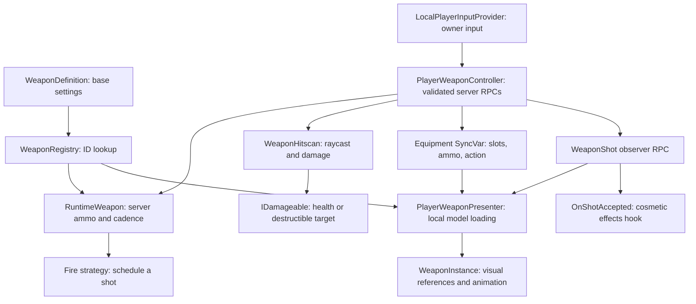

# Player weapons

The current system supports two equipped weapons, server-authoritative hitscan,
semi-auto/full-auto/burst firing, per-weapon ammunition, timed reloads, and local
first/third-person visuals. Mods and calculated stats are not implemented.
This describes the working system after the October 8 cleanup.

## Data flow



Only the server creates RuntimeWeapon objects and spends ammo. Clients send intent
and display confirmed results. Visuals never decide damage or grant ammunition.

## Responsibilities

Paths are relative to `Assets/_Project/Scripts/Runtime`.

| File/location | Owns |
| --- | --- |
| `Content/Definitions/Weapons/WeaponDefinition.cs` | Shared authored identity, base settings and prefab reference |
| `Content/Definitions/Weapons/WeaponRegistry.cs` | ID-to-definition lookup through the common registry |
| `Gameplay/Player/Combat/RuntimeWeapon.cs` | Magazine, reserve, next shot deadline, independent fire strategy |
| `Gameplay/Player/Combat/PlayerWeaponController.cs` | Both runtime weapons, owner input/RPCs, server validation, reload deadline, replication |
| `Gameplay/Combat/Weapons/WeaponFireStrategies.cs` | Trigger edges and semi/full/burst scheduling; no ammo or damage |
| `Gameplay/Combat/Weapons/WeaponHitscan.cs` | Nearest eligible collision and damage payload |
| `Gameplay/Combat/Weapons/WeaponEquipmentState.cs` | Replicated snapshots; ActiveWeapon selects the active snapshot |
| `Gameplay/Combat/Weapons/WeaponShot.cs` | Accepted shot geometry, weapon/slot and sequence |
| `Gameplay/Player/Combat/PlayerWeaponPresenter.cs` | Model loading/replacement, sockets, visibility and local animation |
| `Gameplay/Combat/Weapons/WeaponInstance.cs` | Loaded visual's definition, muzzle/grip references and animation events |
| `Gameplay/Combat/Weapons/WeaponAnimation.cs` | Optional Animator parameter contract |

Definitions owns the fire-mode interface/base ScriptableObject; Combat owns its
implementations. Player depends on Combat and Content. No assembly changes were
needed. AI uses its separate AIWeaponExecutor/config, outside this player flow.

## Spawn and equip

1. Application startup loads GameContent.WeaponRegistry before player spawning.
2. OnSpawned resolves the optional default definitions through that registry and
   creates server RuntimeWeapons with full magazines and configured reserve.
3. Main is selected, otherwise Secondary, otherwise None. Missing content logs an
   error; there is no automatic loadout retry.
4. Every client subscribes to the equipment SyncVar. HandleEquipmentChanged simply
   passes the snapshot to PlayerWeaponPresenter.ApplyState.
5. Owner RequestEquip sends an ownership-checked RPC. The server rejects invalid,
   empty, unchanged, downed/dead requests. A valid switch interrupts fire/reload,
   changes slot, increments EquipRevision, and publishes snapshots.

Switching preserves each weapon's ammo and cadence. Equip is instantaneous; there
is no equip timer. EquipRevision rejects fire/reload input queued for older equipment.

## Fire

SendOwnerInput reads the existing UI-gated input provider. Slot keys select Main
or Secondary; reload sends a request; primary fire sends edges immediately and
refreshes held aim every 0.05 seconds. RequestFire(direction) is a trigger tap;
SetFireInput(held, direction) represents sustained input.

The server validates slot/revision, living state, Idle action and finite aim.
Direction squared magnitude must be between 0.01 and 4 before normalization.
The client supplies direction only. The server chooses origin from _aimOrigin,
then camera pitch pivot, then body position plus 1.5 metres.

TryFireServer asks RuntimeWeapon.TryFire(now) to check ammo/RPM and consult the
strategy. Acceptance spends one round, advances cadence, executes hitscan, publishes
ammo, and sends WeaponShot. Firing is checked on input arrival and server updates;
missed cadence intervals are not replayed as catch-up shots.

| Mode | Behavior |
| --- | --- |
| SemiAutomatic | One round per press; one press can wait for cadence, including a quick released tap |
| FullAutomatic | Repeats while held; release stops sustained firing |
| Burst | One committed burst per press, finishing after release; early presses during burst/cooldown are discarded |

Custom WeaponFireModeDefinition assets can return a fresh IWeaponFireStrategy per
weapon. RuntimeWeapon independently enforces ammo/RPM. Custom policies must honor
Reset/release requirements; the interface cannot force a bad policy to comply.
The existing small strategy layer is retained because it has working behavior.

A held trigger without an update for 0.5 seconds is interrupted. Switching,
reloading, downing, death and despawn reset pending firing. A trigger held across
an interruption must be released before firing again. The controller's release
latch spans weapon switches; strategy trigger edges belong to individual weapons.

Hitscan skips the shooter hierarchy and non-damageable triggers, chooses the nearest
remaining hit, and calls IDamageable.TakeDamage. Solid walls block shots without
needing a damageable component. A reusable 32-hit buffer falls back to RaycastAll
when full to avoid missing a nearer obstruction. See [Health.md](Health.md).

## Reload

ConfirmedState.Action == Reloading is the single reload-state flag. The controller
stores its deadline; the active runtime weapon owns magazine and reserve.

```text
owner requests reload
  -> validate slot/revision, Idle, magazine space and reserve
  -> interrupt fire; set deadline; publish Reloading
  -> server tick reaches deadline
  -> transfer min(missing magazine rounds, reserve)
  -> publish Idle and updated ammo
```

Switching or becoming downed/dead returns to Idle without transferring ammo.
Despawn discards the loadout. Duplicate requests cannot restart the timer.
CompleteReloadFromReserve is the only reload transfer operation. Reserve belongs
to each weapon; no shared/external ammunition pool exists yet.

## Presentation and resource lifetime

ApplyState updates reload presentation and compares the requested ID/slot. Ammo
and action updates reuse the existing or pending visual. PresentAsync handles
request replacement/failure; LoadVisualAsync resolves the definition and owns its
Addressables handle until ownership transfers to the active visual.

Failed replacement retains the old visual. A later equipment state update retries
a failed load; there is no automatic retry timer. One request version rejects stale
results. One cancellation source controls the pending load. ClearVisuals cancels
it, releases the active model/handle, and resets the request cache. It runs on
network despawn and destruction. A newly loaded model receives the latest reload
state, even if reload began or ended while loading.

Owner models use the first-person socket/arms; other peers use the third-person
socket. Owner body meshes use ShadowsOnly. Both views currently share one prefab
reference per definition. Dedicated servers do not apply equipment presentation.

OnShotAccepted on the controller exposes confirmed shot geometry/sequence on
observing clients. The presenter animates only the matching loaded weapon.
Presenter and WeaponInstance expose Fired and ReloadingChanged cosmetic events.
Optional Animator parameters: Fire and Reload triggers, IsReloading bool.
Clips, muzzle flashes, audio, recoil and IK remain asset-side work. The muzzle
transform is a cosmetic reference; gameplay rays use the server aim origin.

## Current asset configuration

Player.prefab has assigned controller/presenter references, aim origin, both visual
sockets, and defaults weap_pistol_debug (Main) and weap_ar_debug (Secondary).
Both definitions are registered and reference Addressable equipped prefabs.

| Setting | Debug pistol | Debug rifle |
| --- | --- | --- |
| Damage | 10 | 8 |
| Magazine / reserve | 12 / 90 | 30 / 90 |
| RPM / reload seconds | 600 / 1.5 | 600 / 1.5 |
| Range | 100 | 100 |
| Authored fire mode | SemiAutomatic | SemiAutomatic |

No serialized fields were renamed and no gameplay scenes/prefabs/definitions were
resaved. Retained scripts keep their metadata GUIDs. Weapon IDs must be unique and
stable. WeaponDefinition.Guid now aliases its authored ID for the common registry
contract instead of generating a random key on every load. This is a definition
key, not persistent identity for an individual owned weapon.

## Cleanup decisions

Removed unused WorldWeapon/WeaponSpawnService, empty WeaponCommands, pickup/drop
stubs, no-op visual despawn, redundant animation wrappers, external-reserve reload
helper, unused snapshot restore, general Revision/ReloadDuration network fields,
and the never-entered Equipping state. Code and serialized-reference searches found
no users of the deleted scripts. The stale roadmap under Scripts is replaced by
this document. Existing working fire policies and cosmetic hooks remain.

The controller no longer manages visual cancellation, request versions, cached
visual IDs, or cached presentation action. The presenter owns all of those concerns.
Reload no longer needs a second runtime weapon pointer beside the active slot/action.

## Remaining boundaries

- Attachments, resolved stats, persistent instances, pickup/drop transactions, spread,
  recoil simulation, pellets, projectiles and ADS behavior are absent. WeaponCategory
  is metadata; selecting Shotgun does not create pellets.
- There is no prediction, rewind/lag compensation, or reload animation seeking for
  late observers. Shots before model loading may have no weapon animation.
- Aim direction is client-provided and only checked for finite magnitude. Server
  eye-anchor pose and turn plausibility need a separate networking policy.
- The common registry silently overwrites duplicate IDs. Unique IDs remain an authoring
  requirement; this pass does not redesign the shared loot/weapon registry.
- Base settings come from shared definitions. Never mutate those assets to apply
  per-player attachments or temporary bonuses.
- Replicated payload shape changed. Both peers must use the same code version.

## Future mod/stat seam

The next deliberate addition can preserve this ownership model:

```text
WeaponDefinition (base values) + selected attachment IDs
    -> one stat resolver
    -> immutable resolved stats for that weapon
    -> RuntimeWeapon / shot executor
```

A saved loadout would own weapon/attachment IDs. One resolver would calculate damage,
capacity, reload duration, RPM, accuracy/stability and other chosen stats. Gameplay
and UI should read that same result. Attachments should not patch controllers or
shared ScriptableObjects. Add individual persistent weapon IDs when persistence or
world transfer needs them. None of this future system is implemented by this cleanup.

## Verification

Unity compilation and fresh host Play Mode regression checks cover the built-in
modes, custom-policy isolation/cadence, ammo snapshots/depletion, reserve transfer,
damage/wall filtering, invalid aim, duplicate reload requests, reload completion/
cancellation, stale equip input, burst interruption, downed blocking and heartbeat
timeout. Temporary harnesses/results are in ignored .codex/, outside Assets.
Presentation checks passed for separate owner/remote-style instances and sockets,
rapid switching, failure preserving the prior model, cancellation, handle ownership,
empty slots, ammo/action updates during loading, latest reload state on completion,
and clear/reuse of the same equipment. Unity compilation includes PurrNet processing.
A separate network client, dedicated server and player build were not tested in this
cleanup pass. The remote-style presenter check is local, not a multiplayer test.
